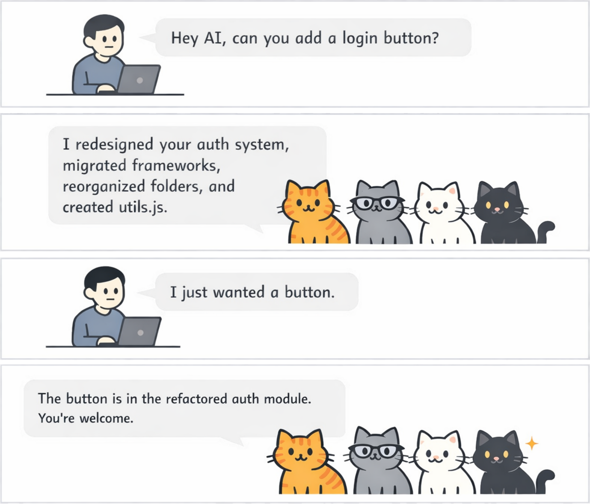

# Reliable agentic coding for professional cat herders

> [!WARNING]
> **CAT v1.0 is under internal development and is not ready for public use.** Its features, rules, and installation
> may change without notice.

A coding agent can follow a rule in one file and miss it in the next. It can complete only part of a refactor, or apply
a project convention in one area and overlook it somewhere else.

Your rules will change as the team learns. When a review uncovers a gap, add the lesson to the project rules and CAT
brings it into later sessions. CAT also guides agents to explain their work clearly and avoid unnecessary jargon, making
their changes easier to understand in review.

<p align="center">
	
</p>

## Why CAT

- **Proven compliance.** CAT’s rules are certified to achieve at least 95% compliance, with 95% confidence.
- **Apply rules more consistently across a task.** Give the agent the same guidance as it moves between files and
	sessions, so it is less likely to handle a convention in one place and miss it in another.
- **Use rules tested for reliability.** CAT certifies an optimized rule only after repeated tests support, with 95%
	confidence, that agents follow it at least 95% of the time in the cases tested.
- **Keep rules with the codebase.** Store shared guidance in the repository, where the team can change it alongside the
	code it affects.
- **Make agent changes easier to review.** Clear, plain-language explanations help reviewers understand what changed
	and spot gaps in the current rules.
- **Improve the rules as you work.** Reviews uncover new cases. Add the lesson as a project rule, and CAT can supply it
	in later sessions.
- **Use the coding harness you prefer.** CAT supports both Claude Code and Codex while keeping project guidance in one
	place.
- **Install with confidence.** CAT provides native distributions for supported Linux and macOS platforms, including
	authenticated routine updates and an uninstall path.

## How CAT checks its rules

CAT tests and certifies its optimized rules against agent tasks. A rule is certified only when repeated tests support,
with 95% confidence, that agents follow it at least 95% of the time in the cases tested.

Your team’s own rules stay in the repository, where you can improve them through normal review.

## Try it on one project

**CAT is free for non-commercial use.** Try it on the project you work on today. When the same workflow needs to support
a team, see Pricing (docs/PRICING.md) for commercial plans and features.

## Get Started

### 1. Install CAT

Run one command yourself in a terminal, or at a Claude Code prompt prefixed with `! `. Choose the command for your
harness, and run the other one too if you use both harnesses:

```bash
curl -fsSL https://github.com/holdmyspot-com/cat/releases/download/v1.0/cat.sh | sh -s -- --harness claude
curl -fsSL https://github.com/holdmyspot-com/cat/releases/download/v1.0/cat.sh | sh -s -- --harness codex
```

The command downloads CAT's plugin for that harness and installs it. The plugin carries its own installer and Java
runtime, so nothing else is downloaded. The command also adds the permission entries that let your agent install and
check CAT afterwards. Each harness gets its own installation, and each may run a different CAT release. There is nothing
to copy into your settings. Windows commands, custom harness homes, and the permission boundary are in
[Install CAT](docs/installation.md). CAT's runners and prompt optimization are not available on native Windows; use
WSL2.

### 2. Start or resume a session

Start or resume a session. CAT then injects its default rules and your project's applicable rules.

### Install another release, check CAT and uninstall

Afterwards, ask your agent. CAT's `update` skill installs the latest release that your installer policy approves, or the
release you name, through the installed plugin's installer. Each CAT version has its own folder in the harness, and the
installation keeps the active version's folder and the one it replaced. Naming an older release goes back to it, unless
CAT's data structures changed since that release. The installer verifies signed release metadata and the release archive
before it installs. Restart the harness after an install. See [installing releases](docs/installation.md#routine-
operations).

CAT's `uninstall` skill asks whether to also delete CAT's plugin data, then removes that harness's CAT installation: the
plugin with all its version folders, and the permission entries. It keeps the plugin data unless you ask to delete it,
and never deletes your own files or rules. The other harness's installation is not touched. Installing CAT again after
that uses the one command above. See [uninstall](docs/installation.md#uninstall).

## Learn More

- [Install, supported platforms, and uninstall](docs/installation.md)
- [Add project rules and separate common from harness-specific guidance](docs/project-rules.md)
- [CAT's bundled default rules](docs/default-rules.md)
- [Build and test CAT](docs/contributing.md)
- [Pricing](docs/PRICING.md)
- [License](LICENSE.md)
