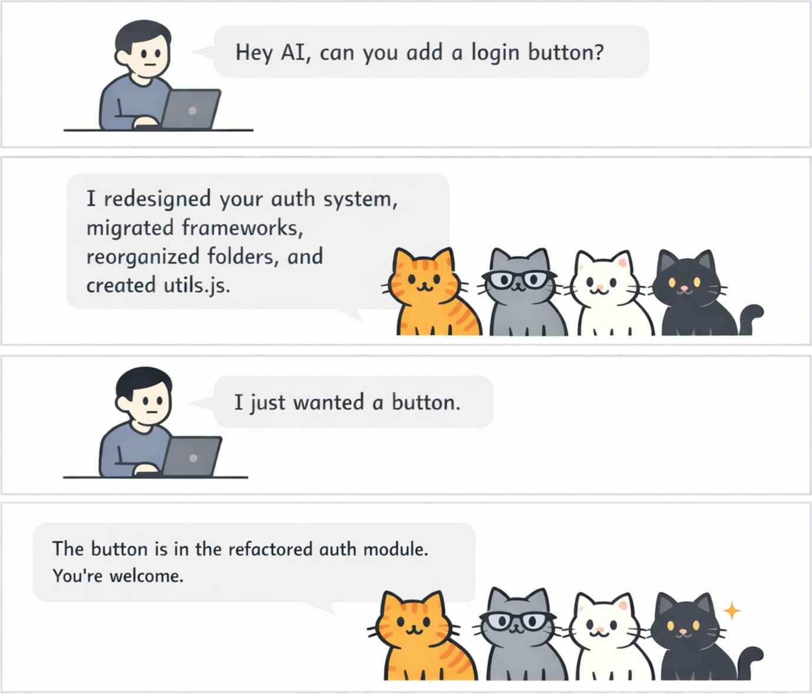

# Reliable agentic coding for professional cat herders

> [!WARNING]
> **CAT v1.0 is under internal development and is not ready for public use.** Its features, rules, and installation
> may change without notice.

A coding agent can follow a rule in one file and miss it in the next. It can complete only part of a refactor, or apply
a project convention in one area and overlook it somewhere else.

Your rules will change as the team learns. When a review uncovers a gap, add the lesson to the project rules and CAT
brings it into later sessions. CAT also guides agents to explain their work clearly and avoid unnecessary jargon, making
their changes easier to understand in review.

<p align="center">
	
</p>

## Why CAT

- **Proven compliance.** CAT’s rules are certified to achieve at least 95% compliance, with 95% confidence.
- **Apply rules more consistently across a task.** Give the agent the same guidance as it moves between files and
	sessions, so it is less likely to handle a convention in one place and miss it in another.
- **Use rules tested for reliability.** CAT certifies an optimized rule only after repeated tests support, with 95%
	confidence, that agents follow it at least 95% of the time in the cases tested.
- **Keep rules with the codebase.** Store shared guidance in the repository, where the team can change it alongside the
	code it affects.
- **Make agent changes easier to review.** Clear, plain-language explanations help reviewers understand what changed
	and spot gaps in the current rules.
- **Improve the rules as you work.** Reviews uncover new cases. Add the lesson as a project rule, and CAT can supply it
	in later sessions.
- **Use the coding harness you prefer.** CAT supports both Claude Code and Codex while keeping project guidance in one
	place.
- **Install with confidence.** CAT provides native distributions for supported Linux and macOS platforms, including
	checksum-verified installation and an uninstall path.

## How CAT checks its rules

CAT tests and certifies its optimized rules against agent tasks. A rule is certified only when repeated tests support,
with 95% confidence, that agents follow it at least 95% of the time in the cases tested.

Your team’s own rules stay in the repository, where you can improve them through normal review.

## Try it on one project

**CAT is free for non-commercial use.** Try it on the project you work on today. When the same workflow needs to support
a team, see Pricing (docs/PRICING.md) for commercial plans and features.

## Get Started

### 1. Select a release

Each bootstrap command installs the latest CAT release by default, verifies the matching platform archive and checksum,
and safely upgrades an existing CAT installation. To install a particular release, append its tag (for example,
`v1.0`). For example, append `v1.0` after the pipe: `| sh -s v1.0`.

### 2. Choose a coding harness

<details>
<summary>Claude Code</summary>

```bash
curl -fsSL \
	https://raw.githubusercontent.com/holdmyspot-com/cat/HEAD/client/claude/lifecycle/src/main/resources/install/bootstrap-claude.sh | sh
```

To install into a custom Claude Code configuration directory, set `CLAUDE_CONFIG_DIR`:

```bash
curl -fsSL \
	https://raw.githubusercontent.com/holdmyspot-com/cat/HEAD/client/claude/lifecycle/src/main/resources/install/bootstrap-claude.sh \
	| CLAUDE_CONFIG_DIR=/path/to/claude-home sh
```

</details>

<details>
<summary>Codex</summary>

```bash
curl -fsSL \
	https://raw.githubusercontent.com/holdmyspot-com/cat/HEAD/client/codex/lifecycle/src/main/resources/install/bootstrap-codex.sh | sh
```

To install into a custom Codex home directory, set `CODEX_HOME`:

```bash
curl -fsSL \
	https://raw.githubusercontent.com/holdmyspot-com/cat/HEAD/client/codex/lifecycle/src/main/resources/install/bootstrap-codex.sh \
	| CODEX_HOME=/path/to/codex-home sh
```

</details>

### 3. Start or resume a session

Start or resume a session. CAT then injects its default rules and your project's applicable rules.

## Learn More

- [Install, supported platforms, and uninstall](docs/installation.md)
- [Add project rules and separate common from harness-specific guidance](docs/project-rules.md)
- [CAT's bundled default rules](docs/default-rules.md)
- [Build and test CAT](docs/contributing.md)
- [Pricing](docs/PRICING.md)
- [License](LICENSE.md)
